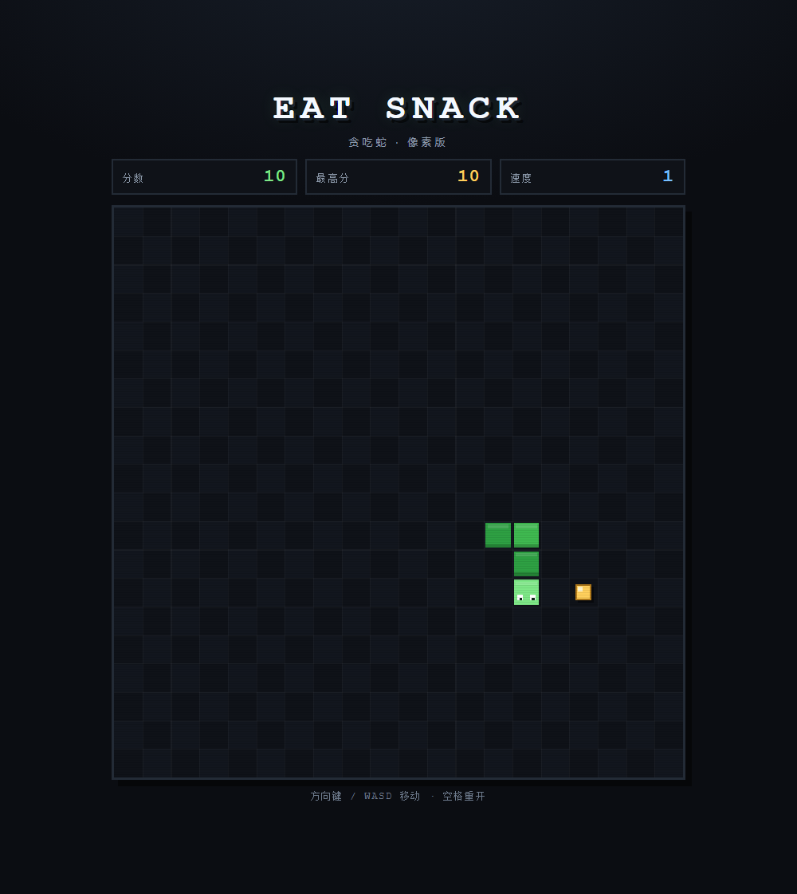

# EAT SNACK · 像素贪吃蛇

一个**单文件、零依赖**的像素风贪吃蛇小游戏。蛇在 20×20 的棋盘上吃零食，别撞墙，也别咬到自己。

- **在线玩**：https://liu2197257-prog.github.io/eat-snack/
- **本地玩**：直接用浏览器打开 [`index.html`](index.html) 即可，不需要安装、构建或起服务器。

## 玩法规则

- 吃到一个零食 **+10 分**
- 每吃 **5 个**升一档速度，共 7 档（每格 180ms → 72ms）
- 撞墙或咬到自己 → Game Over，按 **空格** 立即重开
- 最高分存在浏览器 `localStorage` 里，刷新不丢

## 操作

| 操作 | 按键 |
| --- | --- |
| 移动 | 方向键 或 `W` `A` `S` `D` |
| 开始 | 任意方向键（开局前蛇是静止的） |
| 重开 | `空格`（Game Over 后） |

禁止 180° 掉头：按反方向键会被忽略，不会当场自杀。

## 实现

- `index.html` 一个文件装下 HTML + CSS + Canvas 2D，无任何第三方依赖
- 20×20 固定网格，画布内部按 640×640 渲染，再用 CSS 等比缩放
- `requestAnimationFrame` + 时间累加器固定步长推进，速度随等级切换
- 像素风：棋盘交错的暗格、带高光的方块零食、蛇身明暗条纹、扫描线覆盖层

## 文件

| 文件 | 说明 |
| --- | --- |
| `index.html` | 游戏本体（全部逻辑与样式） |
| `screenshot.png` | 游戏截图 |
| `README.md` | 本文件 |
